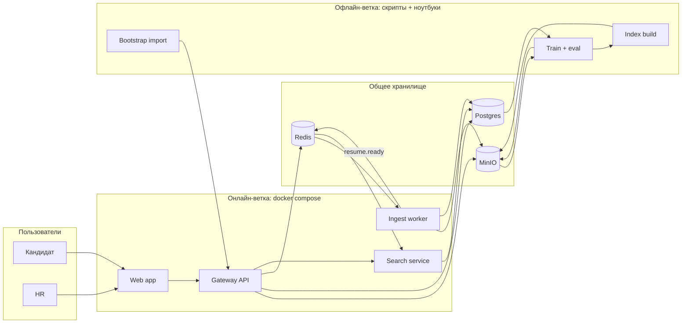
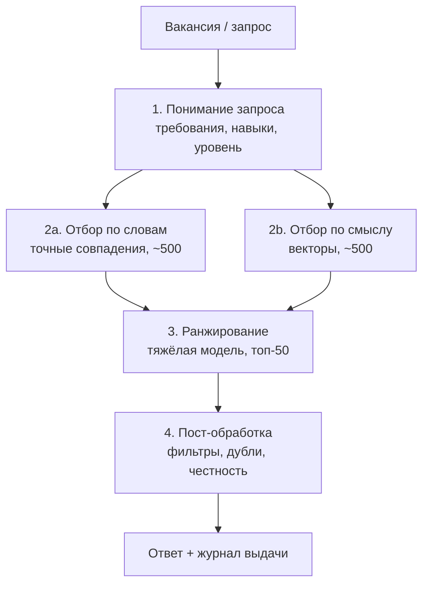
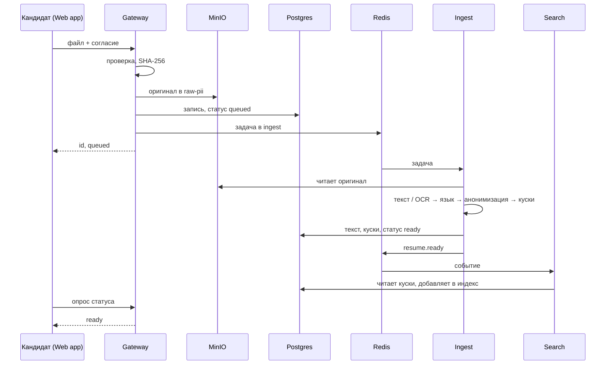
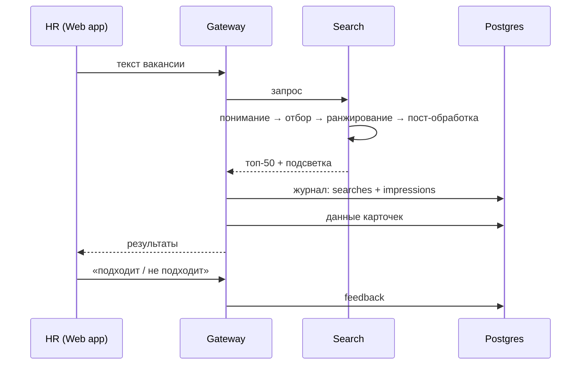
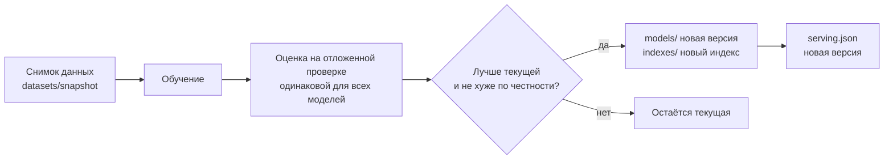

# HR Platform — архитектура (v1)

Это подробный раздел «Архитектура и интеграция» дизайн-документа [DESIGN_DOC.md](DESIGN_DOC.md). Проблема, цели, цена ошибки и метрики — там.

Статус: **согласовано**. Решения от 2026-11-11: резюме из Telegram — вариант А (13.1), time-series CV не делаем, разметка и обучаемые модели — после шаблона, вместе с командой (13.2). Открытые вопросы — раздел 13.
Контракт API между веб-приложением и gateway — в [API.md](API.md) (черновик, нужно обновить под раздел 4).

---

## 1. Что строим

Платформа подбора IT-кандидатов.

- **Кандидат** загружает своё резюме (PDF, Word или фото) через веб-приложение.
- **HR** вставляет текст вакансии и получает топ-50 подходящих кандидатов с подсветкой, что совпало.
- Система сама превращает файл в чистый анонимный текст, хранит его и ищет по нему.

## 2. Ограничения, под которые спроектировано

| Ограничение | Что из него следует |
|---|---|
| Демо работает **локально на ноутбуке** (требование курса) | Всё в `docker compose`, никаких облачных зависимостей |
| Команда **5 человек**, несколько недель | Немного сервисов с чёткими границами, чтобы работать параллельно и не мешать друг другу |
| Модель из сохранённых файлов, без переобучения на демо | Офлайн- и онлайн-ветки разделены, связь через версии моделей |
| Код должен запускаться другими по README | Одна команда запуска, `.env.example`, без ручной настройки |
| Персональные данные реальных людей | Анонимизация на входе, закрытая зона для сырых файлов, ничего личного в git |
| MVP: **только английский**, поиск по словам | Остальные языки сохраняются, но помечаются «не поддерживается» |

## 3. Что у нас уже есть: данные из Telegram

Срез канала `itmarket_uz`, папка `resumes_pdfs/` (посчитано автоматически, без чтения текстов вручную):

| Показатель | Значение |
|---|---|
| Файлов | 2145 PDF, ~977 МБ |
| Уникальных по хэшу содержимого | 1959 (186 точных дублей — перепосты) |
| Период | октябрь 2021 — ноябрь 2026 |
| Страниц | 1 стр. — 1190, 2 стр. — 658, 3+ — 297 |
| С текстовым слоем | 2015; **130 без текста** (сканы/картинки → нужен OCR, ~6 %) |
| Язык (по первым 3 страницам) | en ≈ 1108, ru ≈ 719, uz (латиница) ≈ 96, не определён ≈ 91, без текста 130 |
| По годам | 2021 — 216, **2022 — 1032**, 2023 — 306, 2024 — 247, 2025 — 208, 2026 — 136 |
| Английские: найдены заголовки | Skills 87 %, Education 83 %, Experience 78 %, Projects 62 %, Summary 46 % |
| Английские: личные данные | e-mail 89 %, телефон 76 %, ссылки 59 % |
| Английские: длина | медиана ~240 слов (короткие резюме) |
| Роли (по ключевым словам) | backend и frontend преобладают, затем mobile, DevOps, дизайн |
| Уровень | много «junior» и «intern», «senior» заметно реже |

Выводы для архитектуры:
1. Анонимизация **обязательна** с первого дня — почти в каждом резюме e-mail и телефон.
2. OCR нужен, но редко — достаточно запускать его только для файлов без текстового слоя.
3. Дубли реальны — ID резюме = хэш файла.
4. Данные неравномерны по времени (половина — 2022 год) — учитывать при разбиении на обучение и проверку.
5. Английских ~1000 уникальных — для MVP хватает.

## 4. Пользователи и роли

| Роль | Что делает | MVP |
|---|---|---|
| Кандидат | Загружает резюме, даёт согласие на обработку, может удалить своё резюме | Страница загрузки, без входа в аккаунт |
| HR | Ищет по вакансии, смотрит кандидатов, ставит «подходит / не подходит» | Страницы поиска и кандидатов, без входа в аккаунт |

Без авторизации в MVP — демо локальное. В отчёте это честно указываем как ограничение.

**Согласие.** Форма загрузки содержит обязательную галочку согласия. Флаг `consent` хранится в Postgres. В обучающие наборы попадают только резюме с согласием. Исключение — резюме из Telegram (решение 13.1).

## 5. Общая схема

Система разделена на три плоскости, которые встречаются **только через общее хранилище**:



Поперёк всех плоскостей: защита личных данных, логи, проверка честности (раздел 10).

### 5.1 Развёртывание и порты

Каждый блок — отдельный контейнер в `docker compose`. Наружу открыт только **web**; остальное — во внутренней сети Docker.

| Сервис | Порт | Доступ |
|---|---|---|
| `web` (nginx + собранный интерфейс) | 3000 | **Открыт**: пользователь заходит на `localhost:3000` |
| `gateway` | 8000 | Внутренний (открыт только в режиме разработки) |
| `search` | 8001 | Внутренний |
| `ingest` | — | Фоновый обработчик, порта нет |
| `postgres` / `redis` | 5432 / 6379 | Внутренние |
| `minio` | 9000 (API) / 9001 (консоль) | Внутренние; консоль — только для разработки |

```
Браузер → localhost:3000 → web (nginx)
                             ├── /          → файлы интерфейса
                             └── /api/...   → gateway:8000 → search / postgres / minio / redis
```

- Для браузера это один сайт — CORS не нужен.
- Веб-приложение — отдельный сервис, чтобы интерфейс и бэкенд разрабатывались параллельно и связывались только контрактом [API.md](API.md).
- Разработка интерфейса: dev-сервер Vite с автообновлением, `/api` пересылается на `localhost:8000`. На демо — всё через `docker compose up`.

## 6. Блоки онлайн-ветки

### 6.1 Web app — интерфейс
- Два раздела: **кандидат** (загрузка, статус, удаление) и **HR** (поиск, кандидаты, отметки).
- Общается **только** с Gateway, по контракту из [API.md](API.md).
- Ничего не знает о том, какой алгоритм ищет.

### 6.2 Gateway — единая точка входа
- Проверяет файл (тип, размер), считает SHA-256 — это ID резюме и защита от дублей.
- Кладёт оригинал в MinIO (закрытая зона), создаёт запись в Postgres со статусом `queued`, ставит задачу в очередь.
- Передаёт поисковые запросы в Search, добавляет к ответу данные из Postgres.
- Записывает журнал выдачи (что показали, кому, в каком порядке, какой версией).
- **Сам ничего не вычисляет.**

### 6.3 Ingest worker — файл → анонимный текст
Работает в фоне, берёт задачи из очереди Redis. Шаги:

1. **Текст:** достаёт текстовый слой PDF/Word. Если его нет — OCR (готовая модель, Tesseract).
2. **Язык:** определяет язык. Не английский → `supported = false`, дальше в поиск не идёт, но сохраняется.
3. **Ключ человека:** до анонимизации считает `person_key` = секретный хэш от e-mail/телефона. Сами контакты не хранятся, но разные версии резюме одного человека можно связать.
4. **Анонимизация:** убирает имена, e-mail, телефоны, ссылки, адреса.
5. **Нарезка:** делит резюме на куски по разделам (summary, experience, projects, education, skills).
6. **Сохранение:** анонимный текст и куски — в Postgres; статус `ready`.
7. **Событие:** публикует `resume.ready` в Redis.

Ошибки: 3 попытки, потом задача уходит в очередь ошибок (`ingest:dlq`), статус `failed` с причиной. Ничего не теряется молча.

Вся логика шагов 2–5 — в общей библиотеке `hr_core` (раздел 11), та же, что в офлайн-ветке.

### 6.4 Search service — топ-50
Держит индекс в памяти и отвечает за доли секунды. Внутри — **конвейер из четырёх этапов**, как в индустриальных поисковых системах:



| Этап | MVP | Потом |
|---|---|---|
| 1. Понимание запроса | Токенизация, стоп-слова, словарь навыков (`JS` → `JavaScript`) | Разбор на обязательные / желательные требования |
| 2a. Отбор по словам | **Поиск по ключевым словам** (базовая модель) | Свой BM25 |
| 2b. Отбор по смыслу | — (выключен) | Свой кодировщик, поиск по кускам |
| 3. Ранжирование | Пропускает как есть | Своя модель-«судья» с объяснением |
| 4. Пост-обработка | Фильтры (язык, опыт), один человек — одна карточка (`person_key`) | Проверка честности, разнообразие |

**Алгоритм — сменный модуль.** Какой ранкер и какая версия индекса работают, задаёт файл `configs/serving.json`. Остальная система от этого не зависит, а в интерфейсе можно переключать алгоритм для сравнения.

Индекс обновляется по событию `resume.ready`: новое резюме становится доступным для поиска через секунды после обработки.

## 7. Хранилище

### 7.1 MinIO — файлы (протокол S3, локально)

| Бакет | Что лежит | Кто имеет доступ |
|---|---|---|
| `raw-pii` | Оригиналы файлов, имя = SHA-256 | **Только** Gateway и Ingest |
| `datasets` | Снимки анонимных данных для обучения: `datasets/<snapshot>/…parquet` | Офлайн-ветка |
| `models` | `models/<модель>/<версия>/` — веса + `model_card.json` | Офлайн пишет, Search читает |
| `indexes` | `indexes/<версия>/` — готовые индексы | Офлайн пишет, Search читает |

Почему MinIO, а не AWS S3: демо без интернета, без облачных ключей, личные данные не покидают машину. Переезд в S3 — смена адреса в `.env`.

### 7.2 Postgres — сведения (без файлов)

| Таблица | Что хранит |
|---|---|
| `resumes` | id (хэш), `person_key`, источник (upload / telegram), статус, язык, `supported`, `ocr_used`, страницы, заголовок, навыки, опыт, `consent`, даты загрузки и обработки |
| `chunks` | куски резюме: id, resume_id, раздел, анонимный текст, порядок |
| `searches` | запрос, разобранные требования, ранкер и версия, время ответа |
| `impressions` | что показали: search_id, resume_id, позиция, оценка |
| `feedback` | отметки HR: search_id, resume_id, «подходит / не подходит» |

### 7.3 Redis — очереди и события

| Ключ | Назначение |
|---|---|
| `ingest` | очередь задач на обработку |
| `ingest:dlq` | задачи, упавшие 3 раза |
| `resume.ready` | событие «резюме готово» для Search |

## 8. Основные сценарии

### 8.1 Кандидат загружает резюме



### 8.2 HR ищет кандидатов



### 8.3 Удаление по просьбе кандидата
Удаляется из Postgres, MinIO и индекса; id попадает в список исключений, чтобы не войти в будущие снимки для обучения.

## 9. Офлайн-ветка

### 9.1 Первичная загрузка (bootstrap)
1959 уникальных резюме из Telegram загружаются **через тот же Ingest**, скриптом массовой загрузки, с пометкой `source = telegram`. Отдельного пути обработки нет — данные из канала и от кандидатов обрабатываются одинаково.

Дальше новые данные приходят только от кандидатов через веб-приложение. Скрипт сбора из Telegram больше не нужен (ключи переносятся в `.env`, файл сессии не попадает в git).

### 9.2 Обучение и выкат модели (после шаблона, решает команда)

Обучаемых моделей в MVP нет: поиск по ключевым словам не обучается. Когда команда подключит модель, цикл будет таким:



Как делить данные на обучение и проверку, на каких метках учить и как часто переобучать — решает команда после шаблона (раздел 13.2). Переобучение запускается вручную; расписание — в «пути в продакшен».

### 9.3 Учёт экспериментов (без MLflow)
- `notebooks/` — исследование данных и разбор ошибок; обучение — в `.py`, ноутбук только вызывает.
- `reports/experiments/<дата>_<имя>/` — `config.json` (что запускали), `metrics.json` (что получили), `notes.md` (вывод в 2–3 строки), `plots/`.
- `reports/leaderboard.csv` — по строке на эксперимент → таблица сравнения для раздела 03 требований курса.
- Правило команды: нет папки в `reports/` — эксперимента не было.

### 9.4 Выкат модели
`configs/serving.json` в git — единственный источник правды о том, что работает в демо:

```json
{ "ranker": "keyword", "encoder_version": null, "index_version": "v1" }
```

Версия индекса всегда привязана к версии модели: индекс, построенный моделью v2, не используется с моделью v3.

## 10. Безопасность и личные данные

1. **Зоны.** Сырые файлы с ФИО — только в `raw-pii`. Всё, что после Ingest, — анонимное.
2. **Согласие** при загрузке; в обучение — только с согласием.
3. **Секреты** — в `.env` (в git только `.env.example`). `*.session`, `data/`, `resumes_pdfs/` — в `.gitignore` **до первого коммита**.
4. **Ноутбуки** — без личных данных в выводах; ноутбуки с сырыми данными коммитятся с очищенными выводами.
5. **Удаление** по запросу кандидата — из всех хранилищ и индекса.
6. **Честность** — тест с подменой имён входит в оценку каждой новой модели.
7. **Закон.** В Узбекистане действует закон о персональных данных; насколько известно, данные граждан требуется хранить на серверах в стране — ещё один аргумент за локальное хранилище. Перед отчётом стоит проверить формулировку.

## 11. Структура репозитория

```
hr_platform/
├── docker-compose.yml
├── .env.example
├── .gitignore
├── configs/
│   └── serving.json            # какая модель и индекс работают
├── docs/
│   ├── ARCHITECTURE.md
│   └── API.md
├── packages/
│   └── hr_core/                # общий код: язык, анонимизация, нарезка, навыки, токенизация
├── services/
│   ├── gateway/
│   ├── ingest/
│   ├── search/
│   └── web/
├── offline/
│   ├── bootstrap/              # массовая загрузка Telegram-резюме через Ingest
│   ├── train/
│   ├── eval/                   # метрики, тест честности
│   └── build_index/
├── notebooks/
├── reports/
│   ├── experiments/
│   ├── leaderboard.csv
│   └── figures/
└── data/                       # локально, НЕ в git
```

Python 3.12 во всех образах (3.14 пока рискованно для ML-библиотек).

## 12. Кто за что отвечает

Команда — 5 человек. Распределение зон — позже, решает команда.

Веб-приложение собирается с помощью ИИ-ассистента (Claude). По правилам курса это нужно **честно указать** в отчёте, а тот, кто будет отвечать за веб-приложение, должен уметь объяснить его устройство на Q&A.

### MVP: шаблон за 2 дня
Загрузка → Ingest (текст + OCR + язык + анонимизация + нарезка) → поиск по ключевым словам → топ-50 в веб-приложении → журнал выдачи и отметки HR.

Все сервисы поднимаются одной командой, данные проходят насквозь. Метрик качества в MVP нет — разметки ещё нет.

### Потом, вместе с командой
Разметка → BM25 → свой векторный отбор → «судья» с объяснением → тест честности.

### Путь в продакшен (на слайд, не делаем)
Kafka вместо Redis, Kubernetes, Airflow для расписания переобучения, MLflow, A/B-тесты, авторизация и роли, мониторинг Prometheus + Grafana.

## 13. Открытые вопросы

### 13.1 Резюме из Telegram — решено: вариант А
Используем для обучения и оценки, в демо показываем только анонимно, в отчёте честно описываем источник: публичный канал `itmarket_uz`, согласия на нашу платформу не было.

### 13.2 Разметка и обучаемые модели — после шаблона, с командой
MVP работает на поиске по ключевым словам без метрик качества. Когда команда подключает второй ранкер, нужна разметка, иначе сравнивать нечем. Варианты для обсуждения:
- **А:** страница разметки в нашем веб-приложении.
- **Б:** только отметки HR из демо (мало и смещено).
- **В:** CSV-таблица.

### 13.3 Резюме не на английском (~40 %)
- **А (рекомендую):** сохраняем и помечаем `supported = false` — данные готовы, когда добавим языки.
- **Б:** отбрасываем на входе.
- **В:** перевод на английский готовой моделью перед поиском (заимствование).

### 13.4 Разные версии резюме одного человека
`person_key` связывает версии. В выдаче показываем последнюю? Или все? Рекомендую последнюю.
