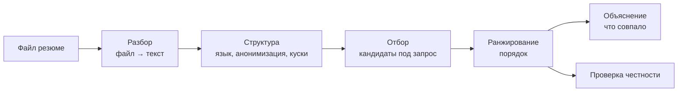

# HR Platform — ML System Design Document

| | |
|---|---|
| Статус | Часть I согласована (2026-11-12). Часть II — в работе: MVP-шаблон, дальше вместе с командой |
| Команда | 3 человека (зоны — раздел 19) |
| Связанные документы | [ARCHITECTURE.md](ARCHITECTURE.md) — подробная архитектура, [API.md](API.md) — контракт API (черновик) |

Документ построен по логике ML System Design: сначала **problem space** (что за проблема, у кого, сколько стоит ошибка, как поймём, что решили), потом **solution space** (как решаем). Решения второй части должны выводиться из первой — если в части II что-то не следует из части I, это повод пересмотреть одно из двух.

---

# Часть I. Problem space

## 1. Проблема

> Рекрутеры IT-компаний тратят часы на ручной разбор резюме, а поиск по ключевым словам пропускает подходящих кандидатов, которые описали те же навыки другими словами.

## 2. Кто страдает и как решают сейчас

| Кто | Как сейчас | Что болит |
|---|---|---|
| **HR / рекрутер** (основной пользователь) | Читает PDF из Telegram-каналов, почты, hh.uz вручную; в ATS фильтрует по ключевым словам | Много времени на первичный отбор; фильтр по словам режет нестандартные формулировки |
| **Кандидат** (второй пользователь) | Отправляет резюме в каналы и на сайты, не знает, прочитали ли его | Хорошее резюме теряется, если не совпало по словам; риск предвзятого отбора |

## 3. Почему это важно

- На первичный просмотр одного резюме рекрутер тратит секунды (известное исследование Ladders — около 7 с), поэтому отбор поверхностный и зависит от совпадения слов.
- Автоматический отбор уже приводит к проблемам предвзятости: исследование Вашингтонского университета (2024) показало сильный перекос по именам у языковых моделей при ранжировании резюме; иск Mobley против Workday (2026) рассматривает ответственность разработчика системы отбора.
- Локальный рынок: в канале `itmarket_uz` за 2021–2026 годы — около 2 тысяч резюме, в основном junior и intern; у начинающих резюме похожи, и отличить их по словам особенно трудно.

## 4. Цена ошибки

| Ошибка | Цена | Почему |
|---|---|---|
| Пропустить подходящего кандидата (false negative) | **Высокая** | Кандидат потерян, и HR даже не узнает об этом |
| Показать неподходящего (false positive) | **Низкая** | HR тратит пару секунд и листает дальше |
| Понизить кандидата из-за имени, пола, возраста | **Очень высокая** | Этика и закон, репутация |

Выводы:
1. Главная метрика — **полнота в топ-50** (Recall@50): подходящие люди должны попасть в выдачу.
2. Вторая — **порядок в первой десятке** (nDCG@10): лучшие — наверху.
3. Честность — **жёсткое ограничение**, а не метрика для оптимизации: новая модель не выкатывается, если тест на подмену имён стал хуже.

## 5. Цели

1. Подходящие кандидаты оказываются в топ-50.
2. Ответ на поиск — быстрее секунды.
3. У каждого кандидата в выдаче — объяснение, что совпало и чего не хватает.
4. Личные данные не видны ни HR, ни модели: всё анонимно.
5. Кандидат сам загружает резюме и может его удалить.

## 6. Анти-цели (сознательно не делаем)

- Не принимаем решение о найме и **не отсеиваем автоматически** — только сортируем и объясняем, решает человек.
- Не прогнозируем зарплату и «успешность» кандидата.
- Не поддерживаем русский и узбекский в MVP (резюме сохраняются, но не ищутся).
- Не проводим собеседования и не связываемся с кандидатами.
- Не собираем новые данные из внешних источников — новые резюме приходят только от кандидатов.

## 7. Ограничения

| Ограничение | Источник |
|---|---|
| Демо локально на ноутбуке, модель из сохранённых файлов | Требования курса |
| 3 человека, несколько недель; шаблон — за 2 дня | Команда |
| Персональные данные реальных людей; закон о персональных данных РУз | Этика, закон |
| Нет разметки на старте | Данные |
| Только английский в MVP | Решение команды |

## 8. Риски

| Риск | Как снижаем |
|---|---|
| Плохое качество данных из Telegram (дубли, сканы, разные форматы) | ID = хэш файла, OCR только для сканов, явные статусы обработки |
| Нет меток — нечем измерить качество | MVP на базовом поиске без метрик; разметка — первый шаг команды после шаблона |
| Предвзятость модели | Анонимизация на входе; тест на подмену имён как обязательное условие выката |
| Утечка личных данных (git, ноутбуки, логи) | Закрытая зона `raw-pii`, `.gitignore` до первого коммита, ноутбуки без личных данных в выводах |
| Ошибки OCR портят поиск | Отмечаем `ocr_used`; в разборе ошибок проверяем такие резюме отдельно |
| Мало английских резюме | ~1000 уникальных уже есть; новые приходят через загрузку |
| Не успеть в срок | Сначала сквозной шаблон с базовым поиском — демо есть всегда |

## 9. Метрики успеха

| Уровень | Метрика | Цель |
|---|---|---|
| Бизнес | Время до готового шорт-листа | ↓ по сравнению с ручным отбором (оценим на демо) |
| Онлайн | Доля отметок «подходит» в топ-10 | Растёт с каждой версией ранкера |
| Офлайн | Recall@50 (главная), nDCG@10 | Задаём после замера базовой линии |
| Ограничение | Сдвиг места при подмене имени | Не хуже текущей модели |
| Нефункциональные | Поиск p95 | < 1 с |
| | Обработка резюме с текстом / со сканом | < 10 с / < 30 с |

Офлайн-метрики появятся, когда будет разметка (раздел 14).

---

# Часть II. Solution space

## 10. Предварительное исследование

### Что уже есть

| Решение | Что делает | Что берём для себя |
|---|---|---|
| LinkedIn Recruiter, Workday, Textkernel | Разбор резюме и подбор под вакансию в больших компаниях | Многоступенчатый поиск: отбор → ранжирование → пост-обработка |
| HaaS (haas-platform.com) | Подбор как услуга: найти ~1000, оставить ~10 | Самое дорогое место — сузить тысячу до полусотни |
| Jobster.hr (Узбекистан) | Массовый найм через анкеты, без разбора резюме | Ниша «IT-резюме + поиск по смыслу» у них не закрыта |
| Resume Matcher и похожие на GitHub | Готовые эмбеддинги + косинус + процент совпадения | Чего у них нет: разметки, своей модели, проверки честности |
| Научные работы (PJFNN, ConFit, бенчмарк PJB 2026) | Нейросетевое сопоставление резюме и вакансий | Переранжирование стабильно добавляет качество |

### Строим или берём готовое

| Компонент | Решение | Почему |
|---|---|---|
| OCR | **Берём готовый** (Tesseract) | Не ядро проекта; честно указываем в отчёте |
| Хранилище, очередь | **Берём** (MinIO, Postgres, Redis) | Стандартная инфраструктура |
| Анонимизация, нарезка | **Строим** (`hr_core`) | Зависит от наших данных |
| Поиск и ранжирование | **Строим** | Ядро проекта, за это баллы |
| Веб-приложение | Строим с помощью ИИ-ассистента | Указываем в отчёте |

## 11. Декомпозиция задачи

Каждая подзадача — отдельный модуль, который можно улучшать и измерять независимо.

## 12. Данные

- **Старт:** 2145 PDF из канала `itmarket_uz` (1959 уникальных), 2021–2026, ~1100 на английском, 130 сканов. Подробный срез — [ARCHITECTURE.md, раздел 3](ARCHITECTURE.md).
- **Политика:** используем для обучения и оценки, в демо показываем только анонимно, источник описываем в отчёте (решение 13.1 в ARCHITECTURE.md).
- **Дальше:** новые резюме загружают сами кандидаты, с согласием на обработку.
- **Анонимизация:** до сохранения текста — почта, телефоны, ссылки, имена.
- **Разметка:** решает команда после шаблона.

## 13. Базовое решение (baseline)

**Поиск по ключевым словам:**
1. Запрос → слова, без стоп-слов, навыки приводятся к одному виду (`JS` → `JavaScript`).
2. Для каждого резюме считаем, сколько слов запроса в нём встретилось.
3. Сортируем, отдаём топ-50, для каждого — совпавшие и недостающие слова.

Зачем начинать с него:
- демо работает с первого дня;
- это точка отсчёта — первая строка таблицы сравнения;
- его слабости показывают, что должна исправить следующая модель.

Известные слабости, которые проверим разбором ошибок: синонимы и другие формулировки, опечатки OCR, короткие резюме, «набивка» ключевыми словами.

## 14. Схема валидации и оценка

Решает команда после шаблона. Рекомендации, вытекающие из части I:
- одна отложенная проверочная выборка, **одинаковая для всех моделей**;
- делить лучше по времени (старые резюме — обучение, новые — проверка), а не случайно;
- версии резюме одного человека (`person_key`) не попадают одновременно в обучение и проверку;
- тест честности с подменой имён — для каждой новой модели;
- time-series CV не делаем (решение от 2026-11-11).

## 15. Архитектура и интеграция

Кратко: три плоскости — онлайн (web, gateway, ingest, search), общее хранилище (MinIO, Postgres, Redis), офлайн (загрузка, обучение, индекс). Они встречаются только через хранилище. Search — конвейер из четырёх этапов, алгоритм ранжирования — сменный модуль.

Подробно — [ARCHITECTURE.md](ARCHITECTURE.md).

## 16. Надёжность и запасные варианты

| Что сломалось | Что происходит |
|---|---|
| Умная модель ранжирования не загрузилась | Search работает на поиске по словам, в ответе указан ранкер |
| OCR упал на файле | 3 попытки, потом статус `failed` с причиной и очередь ошибок |
| Search недоступен | Gateway отвечает понятной ошибкой, загрузка резюме продолжает работать |
| Не определился язык | `language = unknown`, резюме сохраняется, в поиск не идёт |
| Дубль файла | Тот же хэш — возвращаем существующую запись |

## 17. Мониторинг

В MVP — логи и страница `/health`. Что смотрим:
- задержка поиска (p50, p95), ошибки gateway;
- длина очереди Ingest, доля `failed`, доля резюме через OCR;
- языковой состав новых загрузок (дрейф данных);
- распределение оценок в выдаче (если вдруг все кандидаты получают одинаковую оценку — что-то сломалось).

## 18. Разбор ошибок (план)

Когда появится разметка: для каждой модели смотрим пропущенных подходящих кандидатов и раскладываем по причинам — другие формулировки, OCR, короткое резюме, ошибка определения языка, ошибка нарезки. Самая частая причина подсказывает, что улучшать следующим.

## 19. Кто за что отвечает

| Зона | Что входит |
|---|---|
| A. Данные и Ingest | `hr_core`, Ingest, bootstrap-загрузка, схема хранилища |
| B. Поиск и ML | Search, ранкеры, обучение, оценка, `reports/` |
| C. Платформа и интеграция | Gateway, `docker compose`, README, демо; владелец веб-приложения |

## 20. План

1. **Шаблон за 2 дня:** все сервисы поднимаются одной командой, резюме проходят насквозь, поиск по словам.
2. **С командой:** разметка → BM25 → свой векторный отбор → «судья» с объяснением → тест честности.
3. **Путь в продакшен (на слайд):** Kafka, Kubernetes, Airflow, MLflow, A/B-тесты, авторизация, Prometheus + Grafana.

Открытые вопросы — [ARCHITECTURE.md, раздел 13](ARCHITECTURE.md).
